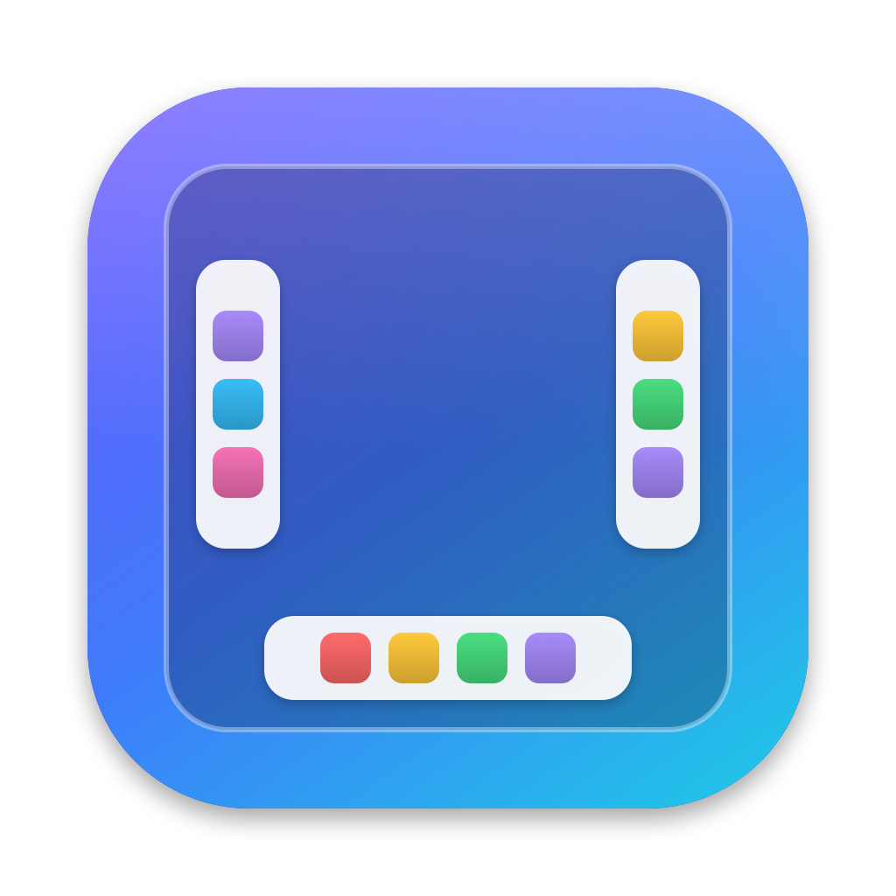
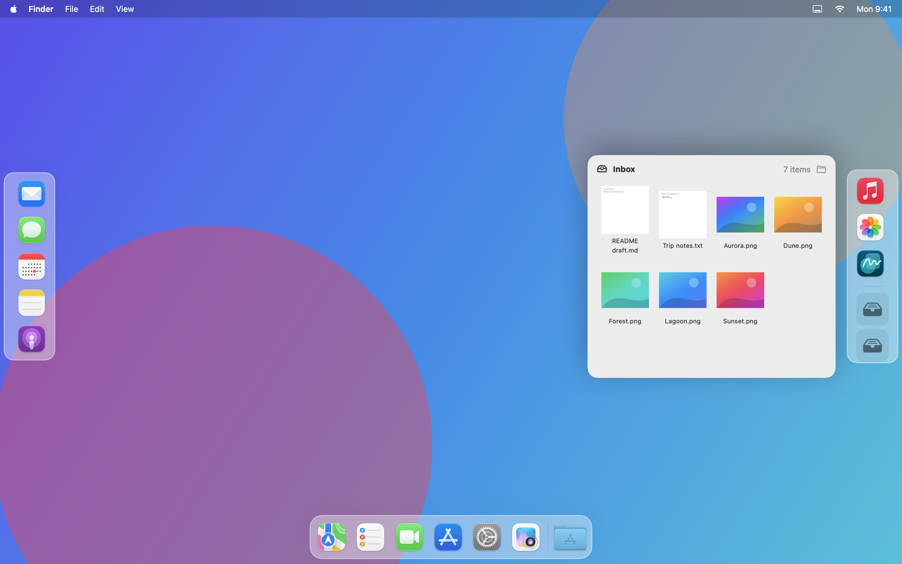
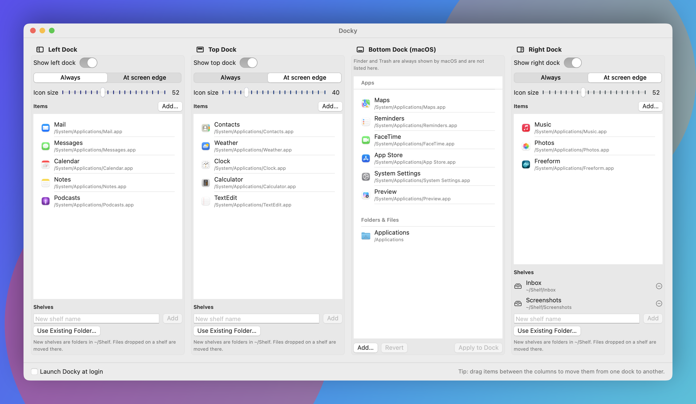
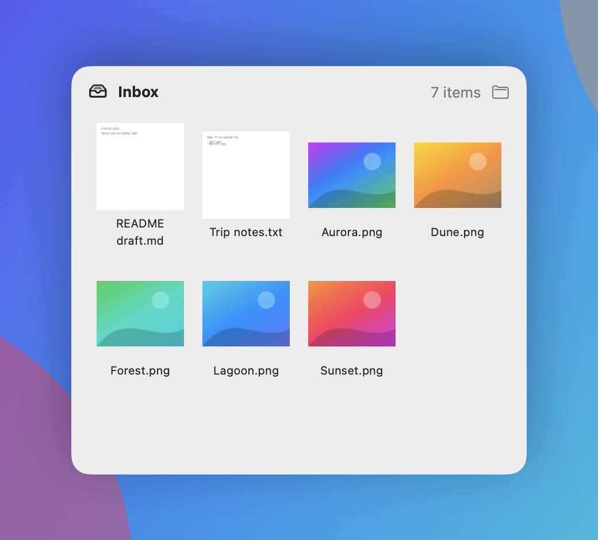

<div align="center">



# Docky

**Extra docks for your Mac: on the left, along the top, on the right, and a tidier one at the bottom.**

Pin the apps you want on any edge of the screen, keep the macOS Dock for everything else,
and drop files on a shelf instead of piling them on the desktop.




</div>

---

## Features

| | |
|---|---|
| 🧭 **Left, top & right docks** | Turn on any combination of docks around the screen. Each has its own apps, folders and files. The top dock sits just below the menu bar. |
| 👻 **Always visible or on demand** | Keep a dock on screen, or let it appear only when the pointer touches that edge of the screen. |
| 🧲 **Drag & drop** | Reorder icons, move them between docks, or drop apps and folders straight from Finder. |
| 🟢 **Running indicators** | A dot shows which apps are open. Right-click to open, quit, show in Finder or remove. |
| 🗂️ **Shelves** | Named drop zones at the end of any Docky dock. Dropped files are *moved* into a real folder, so the desktop stays clean. |
| 🖼️ **Previews & Quick Look** | Shelves show thumbnails of images and videos. Press <kbd>Space</kbd> to preview and drag files back out to any app. |
| ⬇️ **Bottom Dock editor** | Rearrange the macOS Dock itself. A backup is taken before every change, with one-click undo. |
| 🚀 **Launch at login** | Docky can start quietly when you log in and live in the menu bar. |

## Screenshots

<table>
<tr>
<td width="62%"></td>
<td width="38%"></td>
</tr>
<tr>
<td align="center"><sub><b>Customize</b>: all four docks side by side; drag apps between them</sub></td>
<td align="center"><sub><b>Shelf</b>: thumbnails, Quick Look and drag-out</sub></td>
</tr>
</table>

## Getting started

### Requirements

- macOS 15 or later on Apple silicon
- Xcode or the Xcode Command Line Tools (`xcode-select --install`)

### Build & install

```bash
git clone <this-repo> Docky && cd Docky
./scripts/build-app.sh                  # builds build/Docky.app
cp -R build/Docky.app /Applications/
open /Applications/Docky.app
```

On first launch the customization window opens. When you close it, Docky keeps running in the
menu bar, and opening the app again brings the window back.

## Using Docky

1. **Turn on a dock.** Switch on the *Left*, *Top* or *Right* column in the window (or use the menu bar).
2. **Choose how it appears.** *Always visible*, or *Show at screen edge* to reveal it when the pointer touches that edge.
3. **Add items.** Click **Add…**, or drag apps, folders and files from Finder onto a dock.
4. **Rearrange.** Drag items between the columns of the window to move them from one dock to another (including the macOS bottom Dock), or within a column to reorder. You can also drag icons between the live docks. Right-click for more options.
5. **Create a shelf.** Under *Shelves*, type a name (a folder is created in `~/Shelf`) or pick an existing folder.
6. **Edit the bottom Dock (optional).** Reorder, add or drag items into the *Bottom Dock* column, then press **Apply to Dock**.

### How shelves keep you safe

Shelves move files, so Docky refuses anything risky:

- apps, system locations (`/Applications`, `/System`, `/Library`…) and whole volumes
- top-level home folders such as `~/Documents`, and the shelf's own parent folders

Name clashes are never overwritten (`photo.jpg` becomes `photo 2.jpg`). If some files can't be moved,
the rest still are, and Docky tells you which ones were skipped.

### How bottom Dock changes stay safe

- Nothing changes until you press **Apply to Dock** and confirm.
- Your current Dock is exported to `~/Library/Application Support/Docky/Dock Backups` first, and **Undo** restores it.
- Entries Docky doesn't display, such as spacers, are kept in place.

## Development

```bash
./scripts/test.sh                 # unit tests (Swift Testing)
./scripts/build-app.sh            # release build → build/Docky.app
swift scripts/make-icon.swift     # regenerate Resources/AppIcon.icns
```

Regenerate the README screenshots with sample data (debug builds only, never your own Dock or files):

```bash
source scripts/env.sh && swift build
"$(swift build --show-bin-path)/Docky" --render-screenshots "$PWD/docs/screenshots"
```

### Project layout

```
Sources/
├── DockyCore/          Pure, tested logic: dock layout, shelves, config, macOS Dock plist
└── Docky/
    ├── App/            App entry, state, drag payload, bottom Dock editor
    ├── Services/       Running apps, login item, macOS Dock read/write, icons & thumbnails
    ├── Windows/        Floating dock panels, placement and auto-hide
    ├── Views/          Dock, shelf and customization views
    └── Debug/          Screenshot renderer (debug builds only)
Tests/DockyTests/       Swift Testing suites for DockyCore
scripts/                Build, test and icon scripts
```

### Build notes

- With only the Command Line Tools installed, `scripts/env.sh` builds against the bundled macOS 26 SDK.
  The macOS 27 SDK needs SwiftUI macro plugins that only ship with full Xcode.
- `scripts/test.sh` passes the Swift Testing plugin path explicitly for the same reason.

## Known limitations

- Docky's docks appear on the main display (the one with the menu bar).
- On the top edge (shared with the menu bar) and on edges shared with another display, *Show at screen edge*
  waits for the pointer to rest at the edge for a moment, so reaching for a menu or moving between monitors
  doesn't flash the dock.
- An open shelf refreshes after Docky moves files; changes made in Finder show the next time it opens.
